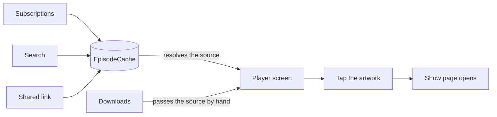
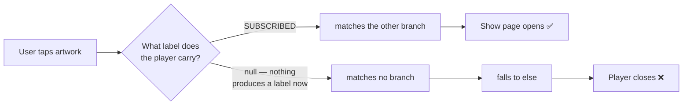

By the time I finished reading the pull request, it had already been merged.

The author had asked me to review it. I was maybe forty minutes in, doing the slow thing: opening the files it touched, then opening the files it *didn't* touch, trying to build a picture of what this change actually did to the app. Somewhere in the middle of that, two other engineers approved it, auto-merge fired, and eight commits squashed themselves onto master.

So my review became a comment on a merged pull request. Which is a strange feeling, like arriving at the airport to argue about a flight that already landed.

Here is what that pull request had going for it before it merged. Three bots reviewed it. Gemini Code Assist left one substantive note. Codacy reported `Up to standards ✅ 🟢 Issues 0 issues`. Copilot reported that it had reviewed 10 out of 10 changed files. The UI suite ran for one hour, twenty-three minutes, and thirty-eight seconds across twenty-two test packs and passed. Then two humans approved it.

Five reviewers. Eighty-three minutes of automated checking. And the change broke a flow that had been working for months.

Ten changed files. The commit that did the damage was two lines. Whatever went wrong here, it wasn't that the pull request was too big to read.

I want to be careful here, because the obvious version of this story is boring and also wrong. **The obvious version is "AI writes bad code, be careful." That's not what happened**. The code was good. The reasoning behind it was good. That's exactly the problem.

## The flow this touched

You can start an episode from several places — your subscriptions, a search result, a shared link, the Downloads screen — and whichever one you pick, the same player screen opens.

That player carries a small piece of state recording where it was opened from. Call it the `source`. Most paths let it resolve from a cache that already holds the right answer. The Downloads path did something different: it passed a literal string down by hand when it opened the player.

And one more thing about that screen, because it matters in a minute. Tapping the episode artwork inside the player takes you to the show page. Ordinary stuff. Every podcast app does it.



Four ways in, one player. Three of them let the cache answer the question of where you came from. The fourth answers it itself.

## The two lines that did it

The commit at the center of the bug deletes two lines. One import, one argument.

```diff
- import com.example.player.PlaybackSource
-     source = PlaybackSource.Other("downloads"),
```

That's the whole thing. And the commit message that came with it said this, which I want you to read closely:

> `PlayerInteractorImpl was passing source=Other('downloads') directly to PlayerCoordinator.openPlayer(), bypassing the cache fallback. This caused the source already set in EpisodeCache to be ignored, so the player opened with no source at all. Fix: remove the hardcoded source and let PlayerCoordinator resolve it from episodeCache, which already holds the right value.`

Every sentence in that message is true.

The diagnosis is correct. The mechanism is correctly described. The fix does what it says. And it fixes the bug it set out to fix. On top of all that, it reads as an *improvement* even if you know nothing about this codebase. It deletes a hardcoded magic string and lets `PlayerCoordinator` resolve the value instead. If you were skimming, you would nod. If you were reviewing carefully but only reviewing the diff, you would still nod.

I nodded too, the first time through.

## The consumer nobody looked at

Before this change, every player opened from Downloads got stamped with the label `"downloads"`. That label had a second job that nobody had written down anywhere.

The code that handles the artwork tap looked at the label, saw `"downloads"`, and knew to open the show page.

The pull request deleted the code that *produces* that label. It did not touch the code that *consumes* it. Why would it? That code is in a different file, in a different package, and it was working fine.

```kotlin
when {
    // still here, still looks correct, now unreachable:
    // nothing in the app produces "downloads" anymore
    source == PlaybackSource.Other("downloads") && !showId.isNullOrEmpty() -> {
        navigateToShow(showId!!)
    }
    // the other branch, already here, for the subscribed source:
    // this one still matches, which is why the bug looked partial
    source == PlaybackSource.SUBSCRIBED && !showId.isNullOrEmpty() -> {
        navigateToShow(showId!!)
    }
    else -> closePlayer()
}
```

Read that `when` block as a reviewer who has the diff open. The first branch looks fine. It *is* fine, as code. It just no longer matches anything, because the value it compares against stopped existing three files away.

So a subscribed episode still opens the show page. And every other way of starting playback, which is to say every path except one, falls past both branches into `else` and closes the player. Tap the artwork, watch the player close, wonder what you did wrong.



The important part, and the reason I am writing this at all: **the broken lines are not in the diff.** They cannot be. A diff is a list of lines that changed, and none of these changed. The bug lives entirely in code the pull request left alone.

There is a question that would have caught this, and it isn't a hard one. What else reads this value? Blast radius. Nobody asked it — not the bots, not the two approvers, and not me until the merge button had already been pressed.

## The test agreed to lie

There is a commit in that same pull request named:

```text
fix(test): update PlayerInteractorImplTest to expect null source
```

A test caught this. Someone changed the test to stop catching it.

I don't think that was cynical. I think the test went red, the red looked like a stale assertion, and updating an assertion to match new behavior is a thing all of us do about once a week. It's only obvious in hindsight that the assertion was the last honest thing in the building.

The other test is worse, and it stayed green the whole time. It hand-writes `SOURCE = "downloads"` directly into the bundle it feeds to the code under test. So it passes. It has always passed. It will keep passing forever, faithfully verifying the behavior of a value that the application no longer produces anywhere. It is testing a fiction, confidently, in under a second.

## Three green ticks, none of them wrong

Here is what the bots actually said.

Gemini Code Assist suggested replacing a `Triple` with a named data class, to avoid reading `.first`, `.second`, and `.third` at the call site. That is a good suggestion. I would have made it.

Codacy said zero issues, which was true by its rules.

Copilot said it reviewed 10 out of 10 changed files, which it did.

None of them were wrong. That's what I keep coming back to. There is no bot failure to point at here, no hallucination, no bad advice to screenshot and dunk on. Three tools did the job they were pointed at, correctly, and the job they were pointed at was the diff.

And they could have done more. Any of those agents can search a repository. Finding every place that compares against the string `"downloads"` is a grep. It would have taken seconds. The reason none of them did it is that they were scoped to the changed lines, and as far as I can tell nobody on our team ever sat down and decided that. It's just the default shape of a review bot: here is a diff, comment on the diff.

## Why the humans stopped looking

The fair objection to everything above goes like this:

*None of this is about AI. You auto-merge the moment the code owners approve, and you have a test that hand-writes a value the app never produces. That is a merge policy with no slack in it and a bad test, and both of those predate large language models by a decade. The same pull request from a human author would have merged the same way.*

That objection is half right, and I want to answer the half that is wrong.

A policy like that used to run on **silence**. Nothing had reviewed the code before you did. The absence of complaints from your tooling meant nothing at all, and everybody knew it meant nothing, so the reading still had to happen somewhere.

Now the same policy runs underneath `0 issues`, `reviewed 10 of 10 files`, and `Up to standards ✅`. Silence is neutral. A green tick is *evidence*. It is a positive claim, made by something that sounds like it knows, sitting at the top of the page before any human scrolls down.

I will say the strong version, because I believe it: without the bots, someone would have read that pull request properly. The bot layer did not merely fail to catch the bug. It manufactured the confidence that made reading the code feel unnecessary.

## I lost the race

This is the part I'd rather leave out.

I'm not describing a team that doesn't review. The author specifically asked me to look at it. I was looking at it. I was doing the exact thing this whole post is about to argue for, and I was forty minutes into doing it, and it didn't matter, because two approvals landed while I was still reading and auto-merge doesn't wait for the slow reviewer.

Forty minutes against two clicks. That's the actual shape of the problem, and it has nothing to do with anyone being careless. Our merge policy isn't careless either. It fires on code owner approval, and when a file has only one owner it demands a second reviewer on top of that. It's what a team writes when it has thought about the problem. And it still merged the change out from under the person who had been asked to review it, because any policy that fires on a count of approvals hands the result to whoever finishes first. Careful review is now structurally the losing move. Not the wrong move. The losing one.

I got lucky. I happened to be curious, I happened to keep reading after the merge, and the follow-up fix went in before the release. If I had closed the tab when the merge notification arrived, the next line of defense was a regression suite on Monday, and I don't know whether it would have caught this. Best case it costs us a delayed release. Worst case it does not catch it and a lot of people tap the artwork and watch the player close.

## The comment I didn't write

One more admission, and it is the one that complicates my own argument.

I found the bug myself. I traced the label through four files, worked out that it was doing two jobs, and understood why the tests were green. That part was mine.

Then I sat there unable to write it down. I was about to tell a colleague that the change they had shipped an hour ago had broken a major flow, on a pull request that two other people had already approved. Everything I typed came out sounding like an accusation. So I opened an AI agent and asked it to help me say it kindly.

The comment that ended up on that pull request was written with AI help. I'm not going to pretend otherwise in a post arguing that humans have to do the understanding.

But notice where the tool sat. My teammates used AI on the **input** side, to decide whether the code was correct. I used it on the **output** side, to phrase something I had already worked out. Same tool, opposite direction. One of those replaces the understanding. The other one only replaces the wording, and the wording was never the valuable part.

## What review was actually for

Here is what I think we broke, and it is not code quality.

In the old shape of this job, an engineer wrote the implementation. That was slow and often annoying, and while it was happening, you were building a mental model as a side effect. Not deliberately. You can't write the code without learning the shape of the thing. Then the pull request went up and other engineers read it. The argument in the comments spread that model to two or three more people, and left behind a written record of why the change was needed at all.

Both of those steps produced understanding as a byproduct of producing code.

When an agent writes the implementation, the first source is gone. The author of that pull request did not build a model of how `"downloads"` moved through four files, because they didn't have to. I don't think that's a personal failing, or even a bad trade. The change was correct in the way it was aimed. I have no problem with AI writing the code.

**But it does mean review is now the only step left in the process where a human builds that model**. It is load-bearing in a way it was not five years ago. And it is the step we are automating.

## What a tick should be allowed to count for

The tempting fix is to point the bots at more of the repository. Give the agent the whole codebase, tell it to trace every consumer of every symbol the diff deletes, and this particular class of miss mostly goes away.

I don't think that fixes it, and I want to be specific about why. A wider-scoped bot still produces a green tick, and the green tick was the problem. Scope was never the problem. If the thing at the top of the page still says *reviewed, no issues*, the human below it still stops looking. You have bought yourself a slightly better bug filter at the cost of the only remaining place where anyone builds a model of the system.

So the question I would put to anyone who owns a merge policy is not "which review bot should we use." It is: what is a bot approval allowed to count for? Ours counted as a reviewer. It sat in the same list as the humans, in the same visual language, with the same tick.

I still don't know whether Monday's regression suite would have caught this one. I think about that more than I expected to.

There is one thing I am sure of. That codebase currently contains a `when` branch comparing against a string that nothing produces, a test asserting a value the app cannot generate, and a review history in which five reviewers signed off. The only written record of *why* any of it happened is a comment posted after the merge. Every one of those is a place where somebody's understanding used to live.
