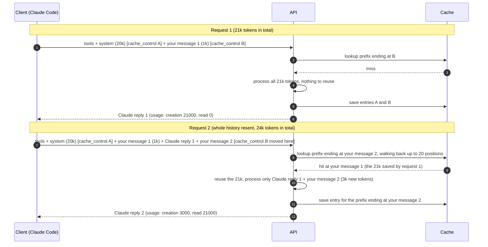
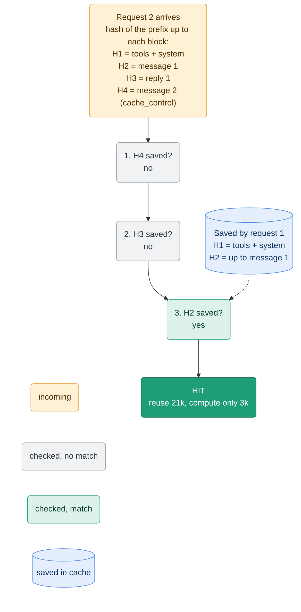
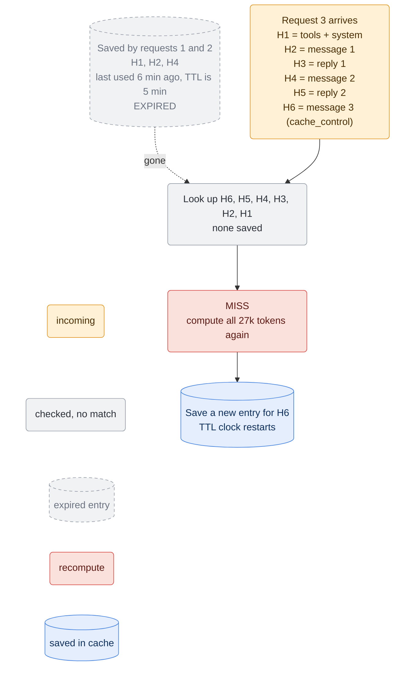

## The question

Have you ever noticed inconsistent response times during a Claude coding session? Or wondered why some API requests drain your credits much faster than others? You've come to the right place. 

If Claude is part of your daily workflow, let's explore some common habits that might be driving up your token usage and slowing down response time. 

## The mental model 

If you are a video game player (especially in open-world video games), you are already familiar with checkpoints (save points). You are not starting the game from the very beginning every time you boot your console. When your checkpoint (save point) is not available anymore on your console (for example, it got deleted), you are going to start the game from the very beginning. In the same way, prompt caching works. 

## How it works 

Let's first agree on some points: 
- **The model is stateless**. Every time you are sending a new prompt all of your context window is being sent to the server. 
- The context window consists of: tools, system prompts, project context, session context, and your messages. 

Let's look more closely at what is happening once you write a message and send it to the model. 

So you decide to open Claude then typed your first prompt and send it to Claude. Once the request is received, everything in the request is computed for the first time. Then again, you continue prompting Claude with another request that carries **the same computed part** plus two things not computed: the **reply** from your first prompt and **your new prompt**. Think of a 1M context window: how much does that cost you when you reach half of your context window? And how long will it take to do the computation for every request from the very beginning and reply to you? 

**That's why prompt caching matters.** 

With prompt caching, the first request is fully computed. When a second request arrives, **only the new, trailing portion is processed**, while the previously computed part is reused from the cache. 

In other words, prompt caching eliminates the repeated work. 
### How does this prompt caching work under the hood? 

You start a new Claude Code session and send your first message; the API request will hold three important data: 
1. System prompts, tools, and your message. 
2. A cache control indicator that identifies the very beginning of the request (tools and system prompts), which will never change during your session.
3. A cache control indicator that identifies the end of your request (your message), which will be changed in a future request (when you continue prompting Claude Code after Claude's first response).

On the server side, it will look up the cache by searching for a prefix ending with the cache control that indicates your message (cache control B). If the cache is **empty**, your request is fully processed from scratch. The system then saves the data between cache controls A and B before replying, though **the final generated response itself is not cached**. If a cache already **exists**, the system reuses it and only processes the new information such as your latest prompt and the previous response, before updating the cache and sending the reply.

> [!NOTE] 
> The lookup starts from the cache control indicator that identifies your message to Claude Code. 

### How the lookup is working 

Claude identifies each block in your context window individually. By scanning backward from your latest message, it locates the first cached match, uses that as a starting point, and then calculates only the remaining, uncached blocks. 

### How Claude will behave in case of a cache miss 

Many scenarios can cause a cache miss, which we will cover shortly. The most common occurs when the cache's Time To Live (TTL) expires, forcing Claude to recompute the entire context window from the start.

You can configure your cache's TTL from Claude Code. Check it [here](https://code.claude.com/docs/en/prompt-caching#choose-the-ttl-yourself).

## Actions that invalidate the cache
- Switching models. 
- Changing efforts. 
- Turning on fast mode. 
- Connecting/Removing an MCP server.
- Enabling/Disabling a plugin.
- Denying an entire tool. 
- Compacting the conversation. 
- Accumulating many images. 
- Upgrading Claude Code. 

## Actions that keep the cache
- Editing files in your repository. 
- Editing `Claude.md` mid-session.
- Changing output style.
- Invoking skills/commands. 
- Running `/recap`.
- Running `/rewind`.
- Spawning a subagent. 
## Gotchas 
- Initially, I used a highly capable model like Opus 5.5 for planning. Once the agent and I agreed on an approach, I switched to the Sonnet model within the same session to begin implementation. However, this workflow increased both my costs and latency.
- While you can add a missing tool mid-session, I highly recommend ensuring all necessary tools are available from the start.
- Don't let your cache cool down. (Some Claude [mods](https://claudecodemods.dev/mods/prompt-cache-control--davila7) can let you know your cache is still warm or cold). 
- The lookup is limited to 20 blocks only, so if Claude's previous response and your new message is more than 20 blocks that will cause a cache miss. 

## Further reading 
- [Claude prompt caching](https://code.claude.com/docs/en/prompt-caching).
- [Prompt caching is everything](https://claude.dev/blog/lessons-from-building-claude-code-prompt-caching-is-everything/).

---

Bringing AI agents into your mobile team? See how I can [help](/work-with-me/).
